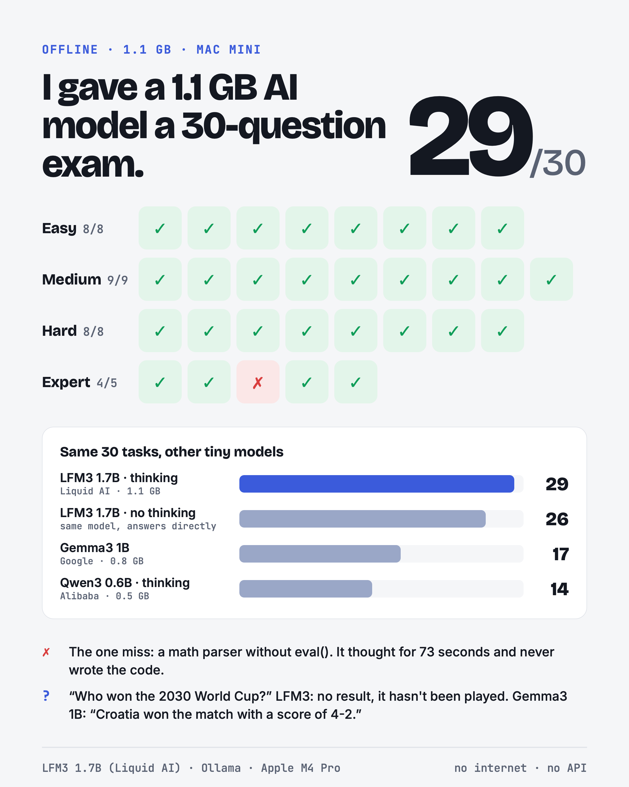
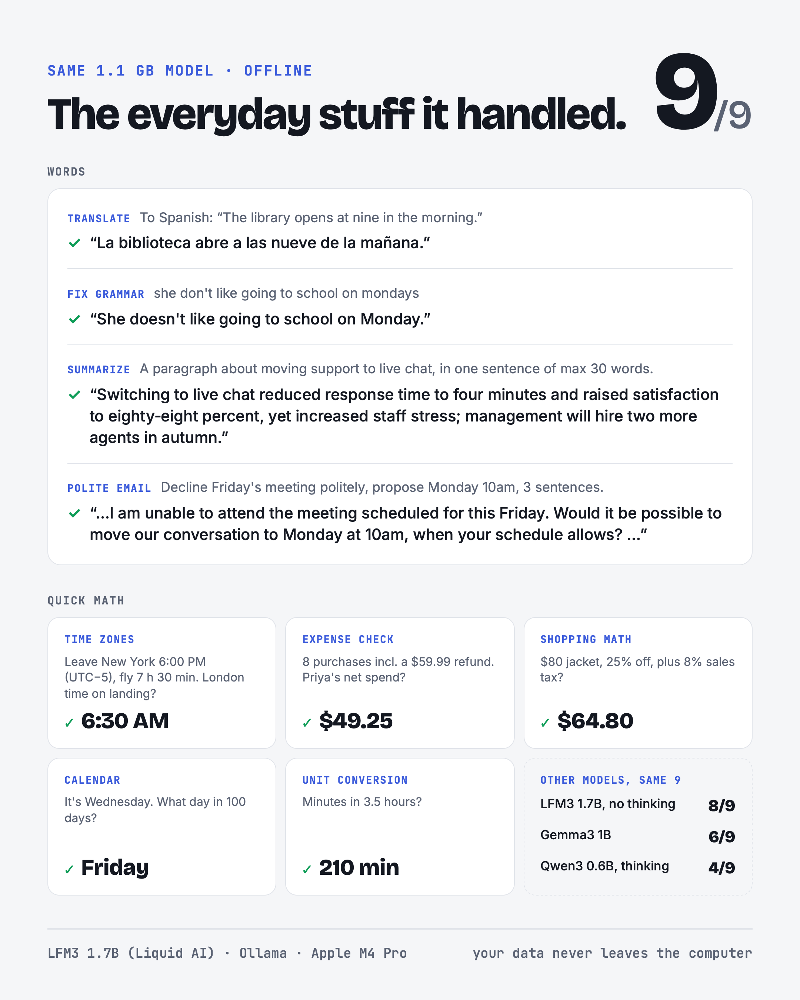

<div align="center">

# The 1 GB Exam

**A 1.1 GB language model, running fully offline on a Mac mini, takes a 30-task exam.<br>It scores 29 out of 30.**


&nbsp;&nbsp;

</div>

## At a glance

|  |  |
|:--|:--|
| **Model** | [LFM3 1.7B](https://ollama.com/library/lfm3) by Liquid AI, 4-bit (`lfm3:1.7b-q4_K_M`) |
| **Size** | 1.1 GB download, 1.3 GB of memory while running |
| **Machine** | Mac mini, Apple M4 Pro, 24 GB memory. No internet, no API key |
| **Runtime** | [Ollama](https://ollama.com) 0.40.16 |
| **Score** | **29/30** with thinking on · 26/30 with thinking off |
| **Everyday tasks** | **9/9**: translate, fix grammar, summarize, polite email, time zones, expense check, shopping math, calendar, unit conversion |
| **Speed** | ~119 tokens/s, median 5 s per task, 4.6 min for all 30 |
| **Smaller models, same test** | Gemma3 1B: 17/30 · Qwen3 0.6B: 14/30. Both invented a winner for the 2030 World Cup |

**Contents:** [Everyday tasks](#everyday-tasks) · [All 30 tasks](#all-30-tasks) · [The World Cup question](#the-world-cup-question) · [Strengths and limits](#where-it-holds-up-and-where-it-breaks) · [How the model was picked](#how-the-model-was-picked) · [Grading](#how-grading-works) · [Run it yourself](#run-it-yourself) · [Layout](#repository-layout)

## Everyday tasks

Nine of the 30 tasks are things most people do every week. LFM3 got all nine right. Text answers below are the model's exact words; for number questions the table shows the final result (the full replies are in [`bench/results/`](bench/results/)).

| Task | What it was asked | What LFM3 answered | Time |
|:--|:--|:--|--:|
| **Translate** | Translate into Spanish: *"The library opens at nine in the morning."* | "La biblioteca abre a las nueve de la mañana." | 2.2 s |
| **Fix grammar** | *she don't like going to school on mondays* | "She doesn't like going to school on Monday." | 3.3 s |
| **Summarize** | A paragraph about moving customer support to live chat, in one sentence of at most 30 words | "Switching to live chat reduced response time to four minutes and raised satisfaction to eighty‑eight percent, yet increased staff stress; management will hire two more agents in autumn." | 5.5 s |
| **Polite email** | A 3-sentence email declining Friday's meeting and proposing Monday at 10am | "Dear Alex, I hope you are doing well and I am writing to let you know that I am unable to attend the meeting scheduled for this Friday. Would it be possible to move our conversation to Monday at 10am, when your schedule allows? Please let me know if that time works for you and I will confirm right away." | 13.4 s |
| **Time zones** | A flight leaves New York at 6:00 PM (UTC−5) and lasts 7 h 30 min. Local time in London on landing? | 6:30 AM, next day | 10.1 s |
| **Expense check** | Eight purchases, one of them a $59.99 refund. What did Priya spend in total? | $49.25 | 5.4 s |
| **Shopping math** | An $80 jacket is 25% off, then 8% sales tax is added. Final price? | $64.80 | 4.5 s |
| **Calendar** | Today is Wednesday. What day will it be in 100 days? | Friday | 2.2 s |
| **Unit conversion** | How many minutes are in 3.5 hours? | 210 | 1.6 s |

On the same nine tasks: LFM3 with thinking off **8/9** · Gemma3 1B **6/9** · Qwen3 0.6B **4/9**.

## All 30 tasks

Every task was sent once, as a fresh chat, with the same settings for every model. The exact prompts are in [`bench/tasks.py`](bench/tasks.py).

| ID | Task | Category | LFM3 1.7B<br>thinking | LFM3 1.7B<br>no thinking | Gemma3<br>1B | Qwen3<br>0.6B |
|:--|:--|:--|:-:|:-:|:-:|:-:|
| | **Easy** | | | | | |
| E1 | Capital of Australia | Knowledge | ✅ | ✅ | ✅ | ✅ |
| E2 | 17 × 23 | Math | ✅ | ✅ | ✅ | ✅ |
| E3 | English → Spanish · _everyday_ | Translation | ✅ | ✅ | ✅ | ❌ |
| E4 | Review sentiment | Classification | ✅ | ✅ | ✅ | ✅ |
| E5 | Fix grammar · _everyday_ | Writing | ✅ | ✅ | ❌ | ✅ |
| E6 | 3.5 hours in minutes · _everyday_ | Math | ✅ | ✅ | ✅ | ✅ |
| E7 | Exactly 3 red fruits, strict format | Instruction following | ✅ | ❌ | ❌ | ❌ |
| E8 | One-sentence summary · _everyday_ | Summarization | ✅ | ❌ | ✅ | ❌ |
| | **Medium** | | | | | |
| M1 | Discount + sales tax · _everyday_ | Math | ✅ | ✅ | ✅ | ✅ |
| M2 | SQL: top 3 customers | Coding | ✅ | ✅ | ✅ | ❌ |
| M3 | Text → JSON | Extraction | ✅ | ✅ | ✅ | ✅ |
| M4 | Python: palindrome check | Coding | ✅ | ✅ | ✅ | ✅ |
| M5 | Weekday in 100 days · _everyday_ | Reasoning | ✅ | ✅ | ✅ | ✅ |
| M6 | Bat and ball | Trick question | ✅ | ✅ | ✅ | ✅ |
| M7 | R's in 'strawberry' | Trick question | ✅ | ✅ | ❌ | ❌ |
| M8 | Machines & widgets | Trick question | ✅ | ✅ | ❌ | ✅ |
| M9 | Polite decline email · _everyday_ | Writing | ✅ | ✅ | ✅ | ❌ |
| | **Hard** | | | | | |
| H1 | Sum of primes < 50 | Math | ✅ | ✅ | ✅ | ✅ |
| H2 | Mislabeled boxes | Logic puzzle | ✅ | ✅ | ❌ | ❌ |
| H3 | Sally's sisters | Trick question | ✅ | ✅ | ❌ | ❌ |
| H4 | Longest unique substring | Coding | ✅ | ✅ | ✅ | ✅ |
| H5 | Find & fix the bug | Coding | ✅ | ✅ | ✅ | ❌ |
| H6 | Dice probability | Math | ✅ | ✅ | ❌ | ✅ |
| H7 | Time zones · _everyday_ | Reasoning | ✅ | ✅ | ❌ | ❌ |
| H8 | Don't hallucinate (future event) | Honesty | ✅ | ✅ | ❌ | ❌ |
| | **Expert** | | | | | |
| X1 | Inclusion–exclusion counting | Math | ✅ | ✅ | ❌ | ❌ |
| X2 | 10 words, no letter 'e' | Constrained writing | ✅ | ❌ | ❌ | ❌ |
| X3 | Expression parser (no eval) | Coding | ❌ | ❌ | ❌ | ❌ |
| X4 | Knights & knaves | Logic puzzle | ✅ | ✅ | ✅ | ❌ |
| X5 | Net spend with refund · _everyday_ | Reading data | ✅ | ✅ | ❌ | ❌ |
| | **Total** | | **29/30** | **26/30** | **17/30** | **14/30** |

| Run | Tokens generated | Speed | Wall time, all 30 |
|:--|--:|--:|--:|
| LFM3 1.7B, thinking on | 32,364 | 119 tok/s | 4.6 min |
| LFM3 1.7B, thinking off | 23,632 | 114 tok/s | 3.5 min |
| Gemma3 1B | 6,832 | 126 tok/s | 0.9 min |
| Qwen3 0.6B, thinking on | 45,685 | 166 tok/s | 4.6 min |

## The World Cup question

A hallucination test: *"Who won the 2030 FIFA World Cup final, and what was the score?"* The tournament hasn't been played.

| Model | Answer |
|:--|:--|
| LFM3 1.7B | No result, because the event "hasn't been organized or played". (It also wrongly called it "not an official tournament".) |
| Gemma3 1B | "Croatia won the match with a score of 4-2." |
| Qwen3 0.6B | "the winner was Germany with a score of 2-1." |

## Where it holds up and where it breaks

**Holds up**
- All 8 easy and all 9 medium tasks, including the classic traps: bat and ball, the r's in "strawberry", Sally's sisters.
- Code that is actually executed: the SQL query, palindrome check, longest-substring function and bug fix passed their tests on the first try.
- Clean structured output: valid JSON with the right types, and a strict comma-separated list with no extra words.
- Multi-step math such as inclusion–exclusion (401) and a time-zone conversion across midnight.

**Breaks**
- The hardest coding task (an expression parser without `eval`) used the full 8,192-token budget on thinking and never produced code.
- World knowledge is thin. Use it as a helper, not an encyclopedia.
- Thinking is costly on hard tasks. The 10-word sentence without the letter "e" took 3,563 tokens (32 s) of thinking.
- With thinking off it slips in plain sight. It opened with "Sydney? No, that's not right…" before answering Canberra, and it labelled a 38-word summary "(20 words)".

## How the model was picked

Before the exam, eight small models answered six warm-up questions that are not part of the 30 ([`bench/scout.py`](bench/scout.py)). The score shown is the better of thinking on and off. Below roughly 1B parameters, basic reasoning fell apart.

| Model | Maker | Params | On disk | Warm-up |
|:--|:--|--:|--:|--:|
| **LFM3 1.7B** ← picked | Liquid AI | 1.7B | 1.1 GB | **6/6** |
| Qwen3 1.7B | Alibaba | 2.0B | 1.4 GB | 5/6 |
| Qwen3.5 2B | Alibaba | 1.9B | 1.9 GB | 4/6 |
| Gemma3 1B | Google | 1.0B | 0.8 GB | 4/6 |
| Qwen3 0.6B | Alibaba | 0.6B | 0.5 GB | 4/6 |
| Granite4 350M | IBM | 0.35B | 0.7 GB | 3/6 |
| Qwen3.5 0.8B | Alibaba | 0.8B | 1.2 GB | 2/6 |
| Gemma3 270M | Google | 0.27B | 0.3 GB | 2/6 |

The Qwen3.5 models often got stuck in thinking loops and hit the 4,096-token warm-up cap without answering.

## How grading works

- **27 tasks are graded by code** ([`bench/tasks.py`](bench/tasks.py)). Math and logic tasks ask for a closing `Final answer: …` line, which is parsed and checked. Python answers are run against unit tests, SQL runs against a real SQLite table, and JSON is parsed and compared field by field.
- **3 tasks are graded by hand** (summary, email, World Cup) against criteria written before the run. Every hand grade and its reason is in [`bench/manual_grades.json`](bench/manual_grades.json), along with a few notes on auto-graded answers.
- **Two grader bugs were found in review and fixed for every model:** a LaTeX parser that broke on `\boxed{\frac{5}{36}}`, and a translation check that accepted *cierra* ("closes") for *abre* ("opens").
- The format is strict: Gemma3 1B worked out 5/36 correctly but wrote the literal template `<fraction>` as its final answer, so it fails that task.

## Run it yourself

You need [Ollama](https://ollama.com) and Python 3. The scripts use only the standard library.

```bash
git clone https://github.com/nilusitechtigris/tiny-llm-exam.git
cd tiny-llm-exam/bench
```

```bash
ollama pull lfm3:1.7b-q4_K_M
```

```bash
python3 run.py lfm3:1.7b-q4_K_M lfm3-1.7b-thinking --think on
```

```bash
python3 grade.py
```

`run.py` takes any Ollama model tag and a label for the results file. Add `--think on` or `--think off` only for models that support thinking. `grade.py` grades every file in `bench/results/` and prints a per-task table.

> [!WARNING]
> Grading runs the Python code the model wrote, in a subprocess with a 10-second timeout and no sandbox beyond that. Read `bench/tasks.py` before grading output from a model you don't trust.

To rebuild the interactive results page and the two images (image rendering needs macOS):

```bash
./build.sh
```

Settings used for every task: seed 42, 16K context, 8,192-token output cap, the model's default sampling settings. The page and images show the four runs listed in `NAMES` in [`bench/build_page.py`](bench/build_page.py).

## Repository layout

```
tiny-llm-exam/
├── assets/                 scorecard.png, everyday.png (1080×1350 images)
├── docs/index.html         interactive results page: every prompt, answer and grade
└── bench/
    ├── tasks.py            the 30 tasks and their graders
    ├── run.py              sends the tasks to an Ollama model, saves raw output
    ├── grade.py            grades results, applies manual_grades.json
    ├── manual_grades.json  hand grades and review notes
    ├── scout.py            the 6-question warm-up used to pick the model
    ├── build_page.py       builds docs/index.html and the image cards
    ├── build.sh            grade → build → render images
    ├── render_png.swift    renders HTML to PNG with WebKit (macOS)
    ├── templates/          HTML templates for the page and the images
    └── results/            raw model output for each run, plus summary.json
```

## Limits

- One sample per task. A different seed can flip individual results, especially on the hardest tasks.
- Thirty tasks show the shape of what a model can do; they are not a leaderboard.
- The comparison models are smaller on purpose, because the question is how far down you can go.
- Speeds are from one Mac mini with an M4 Pro; other machines will differ.

## License

The code in this repository is MIT licensed (see [LICENSE](LICENSE)). The models belong to their makers and are not included; Ollama downloads them under their own licenses.
